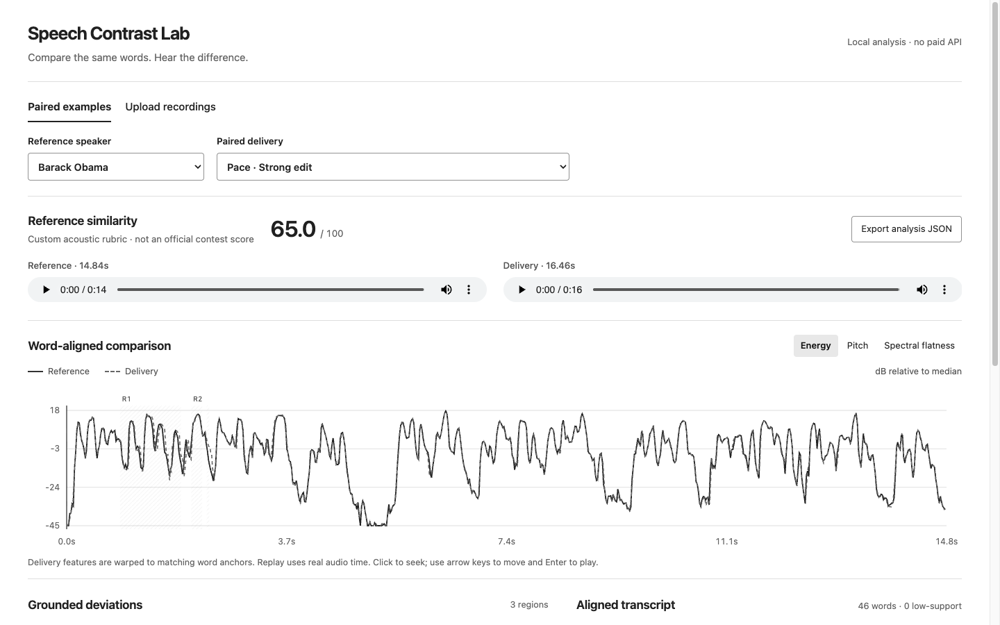

# Speech Contrast Lab

Compare two recordings of the same English text, find local acoustic differences,
and replay the words behind each alert. Built for Track C of the
[Multimodal AI Hackathon 2026](https://multimodal-ai-hackathon-2026-7.devpost.com/).

The prototype includes 34 paired recordings, an upload dashboard, a fixed scoring
rubric and a [six-page technical report](output/pdf/Speech-Contrast-Lab-Technical-Report.pdf).
It runs locally without a paid API, model training or a hosted inference service.

[Download the four-minute captioned demo](docs/demo/speech-contrast-demo.mp4) ·
[English captions](docs/demo/speech-contrast-demo.en.srt)



## Run the dashboard

The verified environment uses Python 3.13.12, Node.js 22.23.3, pnpm 12.8.1 and
FFmpeg. Install FFmpeg with your operating system's package manager before starting.

```sh
python3 -m venv .venv
source .venv/bin/activate
python3 -m pip install -r requirements.txt
npx --yes pnpm@12.8.1 install --frozen-lockfile --ignore-scripts
npx --yes pnpm@12.8.1 build
python3 server.py --port 5276
```

Open `http://127.0.0.1:5276`. Paired examples use recorded analyses and can be
explored without downloading neural-model weights. For new uploads, fetch the
two pinned public checkpoints once:

```sh
python3 scripts/fetch_models.py
```

The helper uses the official Hugging Face CLI and checks the weight hashes.
The downloads total 668,009,789 bytes of weights. Subsequent analysis loads local
safetensors with networking disabled.

Choose an example or upload two files and their shared transcript. The chart
compares energy, normalized pitch or spectral flatness on the reference word
axis. Click an alert or a transcript word to hear its delivery interval. Arrow
keys seek in 0.25-second steps; Shift changes the step to one second. Enter plays.
Export JSON for the word measurements, score components and plotted features.

## Dataset and measured results

The source clips are public-domain White House weekly addresses by Barack Obama
and Joe Biden. The reference clips last 14.835 and 6.665 seconds. Each has three
levels of pace, pause, local-volume and added-noise edits, plus unchanged,
global-volume and global-pitch controls. Four additional noise realizations bring
the total to 34 pairs. See [the dataset notes](docs/DATASET.md) for sources,
transcripts, edit boundaries, hashes and the meaning of each label.

The published `contrast-v2.0` evaluation reports:

| Check | Result |
| --- | ---: |
| Moderate/strong target-region hits | 16 / 18 |
| Near-perfect target-region hits | 0 / 10 |
| Controls with a false alert | 1 / 6 |
| Pairs receiving a score | 34 / 34 |
| Frozen analyses reproduced exactly | 34 / 34 |

A target hit requires a matching alert family with interval IoU of at least 0.25.
This is a localization test, not an assessment of rhetorical quality. The
predeclared v2 gate required at least 93% moderate/strong hits and no control false
alerts; **it failed**. The dashboard shows every pair, including both strong-case
misses and the pitch-control false alert. None of the ten subtle targets was
localized by a matching alert family; off-target alerts can still occur.

The v2 evaluation replayed 30 known examples and added four new perturbations on
the same speakers. It is not a new blind-speaker benchmark. Exact software replay
does not change the failed experiment result.

## Reproduce and test

```sh
python3 scripts/reproduce.py
python3 -m unittest discover -s tests -v
npx --yes pnpm@12.8.1 test
npx --yes pnpm@12.8.1 build
npx --yes pnpm@12.8.1 audit
```

The replay verifies waveform and analysis hashes, then recomputes all 34 analyses
from the frozen word times. It performs no neural inference. Its expected output
includes `reproduction_passed: true` and `experiment_gate_passed: false`.
The verified test set contains 20 Python tests and two JavaScript tests; the
production build passed and the full dependency audit reported zero advisories.

## How it works

1. FFmpeg decodes bounded local audio to 16 kHz mono PCM.
2. Frozen Whisper independently checks the supplied transcript. Agreement below
   90% in either recording produces no score.
3. Frozen wav2vec2 CTC alignment estimates each word interval and acoustic support.
4. FFT, 13 MFCC coefficients, autocorrelation F0, word durations and gaps feed the
   fixed comparison rules. Pitch and energy are normalized within each recording.
5. Four weighted penalties produce reference similarity: pace 35, pause 25,
   relative volume 25 and spectral noise 15. Every alert includes a numerical
   explanation and its playback interval.

The [technical report](output/pdf/Speech-Contrast-Lab-Technical-Report.pdf) contains
the feature equations, thresholds, score formula, architecture and evaluation.
`speechcontrast/` holds the analysis modules; `server.py` serves the loopback API;
`web/src/` holds the React interface. Historical manifests and v1 feature code are
retained separately from the canonical `data/manifest.json`.

## Scope and privacy

Uploads must contain the same English transcript: 0.5–30 seconds and at most 8 MB
per file, with at most 1,200 transcript characters and 180 words. WAV, MP3, FLAC,
OGG and WebM are supported. The server accepts loopback, same-origin requests,
runs one comparison at a time, and deletes temporary uploads before returning the
response. It does not log audio, transcripts or local filenames.

Word times are model estimates, not manually verified timing labels. Edit
intervals identify what was changed, not what a human judge considers bad.
Two speakers are insufficient to establish generalization across voices,
accents, microphones or speaking genres. A quiet recording, intentional emphasis
or changed microphone can affect the measurements. Reference similarity is not
an official contest score, a measure of persuasiveness, or a ranking of people.

## Models, licensing and AI assistance

- [`facebook/wav2vec2-base-960h`](https://huggingface.co/facebook/wav2vec2-base-960h),
  Apache-2.0, revision `22aad52d435eb6dbaf354bdad9b0da84ce7d6156`.
- [`openai/whisper-base.en`](https://huggingface.co/openai/whisper-base.en),
  Apache-2.0, revision `911407f4214e0e1d82085af863093ec0b66f9cd6`.
- Project code: [MIT](LICENSE). Source speech clips: public domain according to
  their archive pages. Project-created edits and annotations: [CC0](data/LICENSE.md).
  Model weights are not included in the repository.

OpenAI Codex assisted with implementation, tests, documentation and demo
assembly. It will be listed in the submission's Built With field. Neither model
was trained or fine-tuned for this project. Recorded results are included without
removing failures or relabeling the failed validation gate.
